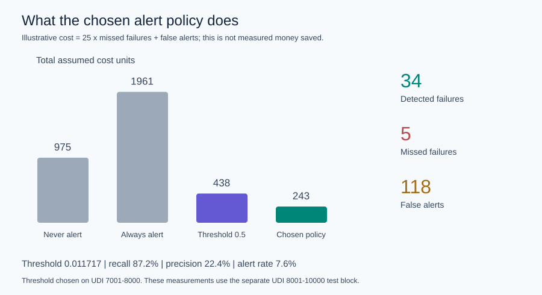
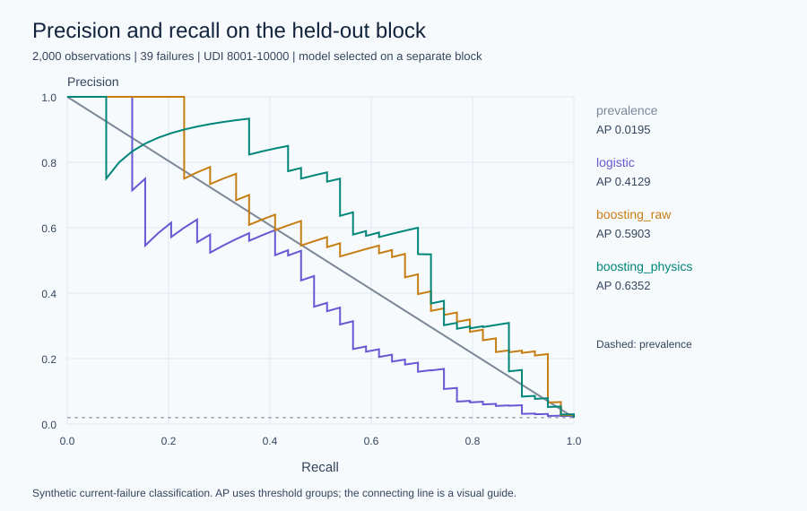

# Machine Failure Cost Lab

A reproducible machine-failure classification project that asks a practical question: **how should an alert threshold change when missed failures are more expensive than false alarms?**

The project compares four small NumPy models, adds three physically motivated features, and selects an operating threshold on a separate policy block. It includes the source data, a portable JSON model, recorded predictions, exact SVG charts, and a tested command-line workflow.

**Scope:** this is an educational benchmark on synthetic, contemporaneous failure labels. It does not demonstrate advance warning, remaining useful life, or real maintenance savings.



## Recorded result

The model and alert policy were chosen before test evaluation.

| Held-out test measurement | Result |
| --- | ---: |
| Observations / failures | 2,000 / 39 |
| Average precision (AP) | 0.6352 |
| ROC-AUC | 0.9540 |
| Detected / missed failures | 34 / 5 |
| False alerts | 118 |
| Recall / precision | 87.2% / 22.4% |
| Alert rate | 7.6% |
| Assumed cost at a 25:1 miss/false-alert ratio | 243 units |
| Cost at the same model's 0.5 threshold | 438 units |
| Cost of never alerting | 975 units |

The lower threshold catches more failures but produces many false alerts: about 78% of alerts are false positives. The cost comparison is conditional on the illustrative 25:1 assumption. Neither intervention success nor real expenses were measured.

[Full results and uncertainty](reports/RESULTS.md) · [Machine-readable results](reports/results.json) · [Review notebook](notebooks/review_results.ipynb)

## Run it

Tested with Python 3.12.14, NumPy 2.3.5, and pandas 3.0.1. From this directory:

```bash
python -m venv .venv
# Windows PowerShell: .venv\Scripts\Activate.ps1
# macOS / Linux: source .venv/bin/activate
python -m pip install -r requirements.txt
python -m unittest discover -s tests -v
python -m failurelab predict --input examples/sensors.csv --output local_predictions.csv
```

The committed JSON model supports prediction immediately. To reproduce the benchmark in a separate output directory:

```bash
python -m failurelab train --output reports/reproduction
```

Training requires no network, GPU, external model weights, or API key. It checks the bundled dataset's SHA-256 before fitting. New runs overwrite files within the selected output directory; use a new directory to retain earlier results.

## Inputs and outputs

| Required CSV column | Meaning |
| --- | --- |
| Type | H, L, or M |
| Air temperature [K] | Air temperature in kelvin |
| Process temperature [K] | Process temperature in kelvin |
| Rotational speed [rpm] | Shaft speed |
| Torque [Nm] | Torque |
| Tool wear [min] | Tool wear time |

Prediction outputs are `risk_score`, `alert`, and `threshold`, plus row number and optional UDI. Scores have not been separately calibrated, so they should not be presented as reliable failure probabilities.

An explicit input allowlist discards identifiers, targets, failure-mode labels, and other extra columns. Missing sensors, unknown types, non-finite readings, and invalid signs are rejected.

## Evaluation design

| Block | UDI range | Rows | Failures | Use |
| --- | --- | ---: | ---: | --- |
| Training | 1–5500 | 5,500 | 247 | Fit preprocessing and all models |
| Model selection | 5501–7000 | 1,500 | 31 | Choose highest AP |
| Policy selection | 7001–8000 | 1,000 | 22 | Minimize assumed error cost |
| Test | 8001–10000 | 2,000 | 39 | Evaluate frozen decisions |

These are disjoint blocks in the original row order. **UDI is not a verified timestamp or machine identity.** This is neither a validated temporal holdout nor a machine-group holdout.

The four candidates are a prevalence baseline, regularized logistic regression, raw-feature Newton tree boosting, and boosting with temperature gap, mechanical power, and wear-times-torque. The feature combinations are informed by the dataset's documented generation process; they are not a claim of a new algorithm.



The selected model is `boosting_physics`. All hyperparameters and split boundaries were fixed before the first benchmark run. A separate `frozen_decision.json` is written before test metrics. The test comparison is descriptive, not a new model-selection step.

## Project map

| Path | Contents |
| --- | --- |
| `failurelab/` | Feature validation, NumPy estimators, metrics, policies, CLI, plots |
| `tests/` | 20 tests for leakage, mathematics, validation, and serialization |
| `experiment_plan.json` | Fixed protocol and implementation settings |
| `data/` | Exact source CSV, attribution, checksum |
| `examples/` | Sensor CSV and recorded inference example |
| `reports/` | Frozen decision, selected model, measurements, predictions, charts |
| `notebooks/` | Executable review of the saved results |
| `docs/` | Method, model card, development record, verification |

## Limitations and next work

There are only 39 test failures and 22 policy-selection failures. Conditional bootstrap intervals are wide; they do not include model fitting, selection, or deployment shift. The 100-row bootstrap block size is an assumption, not a verified dependence length.

The custom NumPy estimators make the mathematics inspectable and avoid additional compiled dependencies. They are reference implementations, not production replacements for established ML libraries.

A credible operational extension requires timestamped data from distinct machines, a future failure horizon, measured maintenance costs, calibration, and a new untouched evaluation set. Repeated tuning on this test block would invalidate its role as a holdout.

## Sources and license

Data: [UCI AI4I 2020 Predictive Maintenance Dataset](https://doi.org/10.24432/C5HS5C), shared under [CC BY 4.0](https://creativecommons.org/licenses/by/4.0/). See [data/README.md](data/README.md) for attribution and provenance.

Code and original documentation: [MIT](LICENSE), copyright 2026 Ehsan Cheraghi. The dataset retains its own license. Method references and implementation details are in [docs/METHOD.md](docs/METHOD.md).
